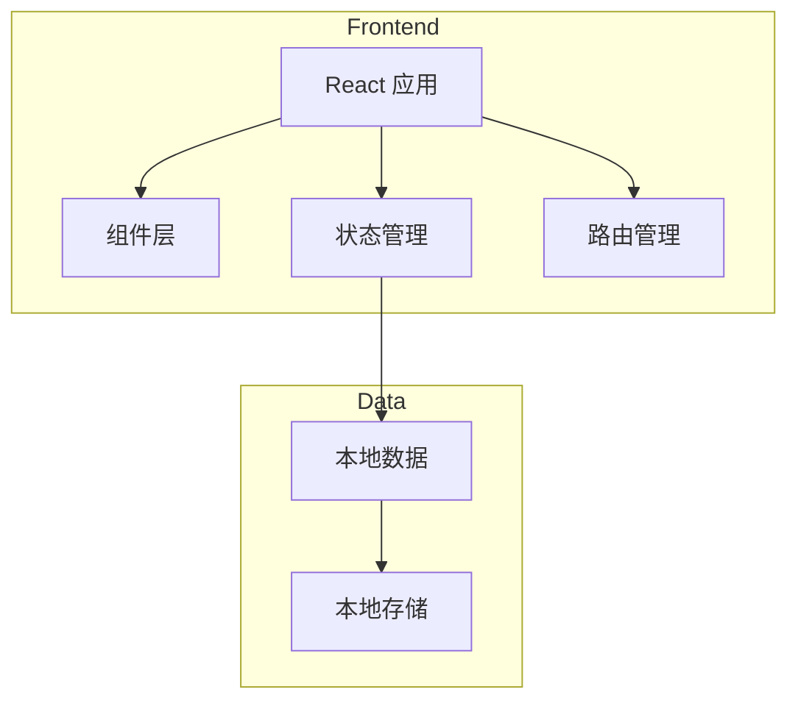

## 1. 架构设计


## 2. 技术描述
- **前端**：React@18 + TypeScript + tailwindcss@3 + vite
- **初始化工具**：vite-init
- **后端**：无（纯前端应用，数据存储在本地）
- **数据存储**：localStorage

## 3. 路由定义
| 路由 | 用途 |
|-------|---------|
| / | 首页 - 专题选择和统计 |
| /topic/:id | 专题页面 - 题目列表 |
| /quiz/:topicId/:questionId | 刷题页面 |
| /results/:topicId | 成绩页面 |

## 4. 数据模型

### 4.1 数据定义
```typescript
interface Question {
  id: string;
  topicId: string;
  content: string;
  options: string[];
  correctAnswer: number;
  explanation: string;
  memoryTip: string;
  year?: number;
  difficulty: 'easy' | 'medium' | 'hard';
}

interface Topic {
  id: string;
  name: string;
  description: string;
  questionCount: number;
  icon: string;
}

interface UserProgress {
  topicId: string;
  completedQuestions: string[];
  correctAnswers: number;
  totalAttempts: number;
}
```

### 4.2 专题列表
- 会计
- 审计
- 财务成本管理
- 公司战略与风险管理
- 经济法
- 税法

每个专题包含至少300道题目，总题量超过5000题。
