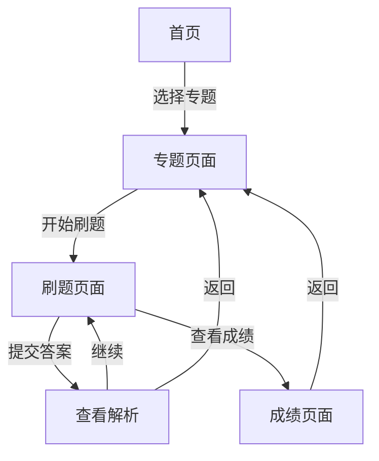

## 1. 产品概述
CPA刷题网站是一个专为注册会计师考试设计的在线刷题平台，提供海量真题和AI增强解析，帮助考生高效备考。
- 目标用户：准备CPA考试的学生和专业人士
- 解决问题：提供系统的、高质量的真题练习和易懂的答案解析

## 2. 核心功能

### 2.1 用户角色
| 角色 | 注册方式 | 核心权限 |
|------|----------|----------|
| 普通用户 | 无需注册 | 浏览题目、刷题、查看解析 |

### 2.2 功能模块
1. **首页**：专题选择、统计数据展示、快速刷题
2. **专题页面**：专题介绍、题目列表、进度跟踪
3. **刷题页面**：题目展示、选项选择、答案提交、解析查看
4. **成绩页面**：答题结果、错题记录、知识点分析

### 2.3 页面详情
| 页面名称 | 模块名称 | 功能描述 |
|----------|----------|----------|
| 首页 | 专题网格 | 展示所有CPA专题，点击进入专题页面 |
| 首页 | 统计面板 | 显示总题数、已完成题数、正确率等数据 |
| 专题页面 | 题目列表 | 展示专题内所有题目，支持筛选和搜索 |
| 刷题页面 | 题目卡片 | 显示当前题目、选项、答题状态 |
| 刷题页面 | 解析面板 | 显示AI增强的详细解析 |

## 3. 核心流程
用户从首页选择专题 → 进入专题页面浏览题目 → 选择题目开始刷题 → 提交答案查看解析 → 继续刷题或查看成绩统计

## 4. 用户界面设计

### 4.1 设计风格
- **主色调**：深蓝色 (#1e3a5f) 配合金色 (#d4af37) 作为辅助色
- **按钮风格**：圆角矩形，带微妙阴影效果
- **字体**：使用 Noto Sans SC（中文）和 Inter（英文）
- **布局风格**：卡片式布局，层次分明
- **图标风格**：简洁现代的线性图标

### 4.2 页面设计概述
| 页面名称 | 模块名称 | UI元素 |
|----------|----------|--------|
| 首页 | 专题网格 | 渐变背景、卡片悬停效果、进度条 |
| 刷题页面 | 题目卡片 | 淡入动画、选项高亮、反馈提示 |
| 解析面板 | 解析区域 | 分栏布局、知识点高亮、记忆技巧 |

### 4.3 响应式
采用桌面优先设计，同时完美适配平板和移动设备，确保在各种屏幕尺寸下都有良好的用户体验。
