# CPA 刷题网站 - 技术架构文档

## 目录

- [系统架构图](#系统架构图)
- [技术栈说明](#技术栈说明)
- [模块关系图](#模块关系图)
- [数据流程图](#数据流程图)
- [用户流程时序图](#用户流程时序图)
- [状态管理图](#状态管理图)
- [组件层级图](#组件层级图)
- [部署架构](#部署架构)

---

## 系统架构图

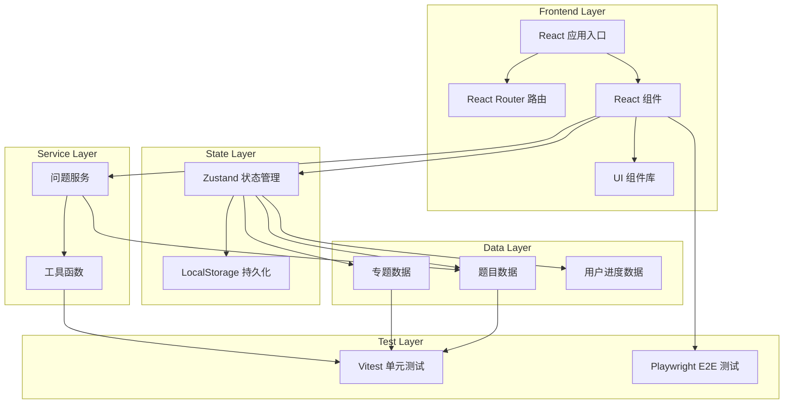

---

## 技术栈说明

### 核心技术

| 技术 | 版本 | 用途 | 为什么选择 |
|------|------|------|-----------|
| **React** | ^18.3.1 | 用户界面库 | 组件化、生态丰富、性能优秀 |
| **TypeScript** | ^5.2.2 | 类型安全 | 类型检查、IDE 支持、可维护性 |
| **Vite** | ^6.4.0 | 构建工具 | 极快的启动速度、热更新、优化构建 |
| **Tailwind CSS** | ^3.4.17 | CSS 框架 | 原子化 CSS、快速开发、设计系统 |
| **Zustand** | ^5.0.3 | 状态管理 | 轻量、简单、无 Boilerplate |
| **React Router** | ^7.5.3 | 路由管理 | 声明式路由、嵌套路由、导航 Hooks |

### 开发工具

| 工具 | 用途 |
|------|------|
| **Vitest** | 单元测试 |
| **Playwright** | E2E 测试 |
| **ESLint** | 代码检查 |
| **PostCSS** | CSS 处理 |

### 图标库

| 库 | 用途 |
|----|------|
| **Lucide React** | 开源图标 |

---

## 模块关系图

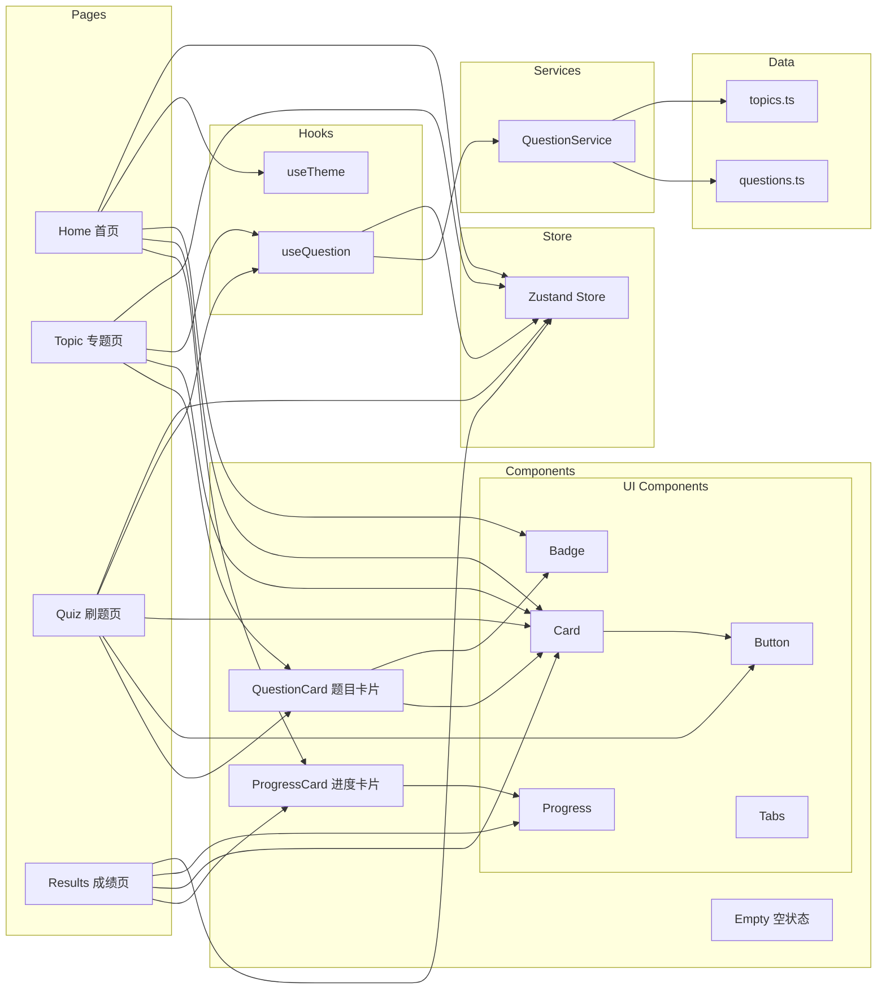

---

## 数据流程图

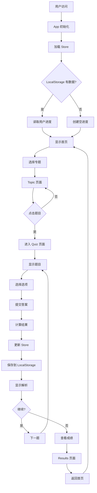

---

## 用户流程时序图

### 完整刷题流程

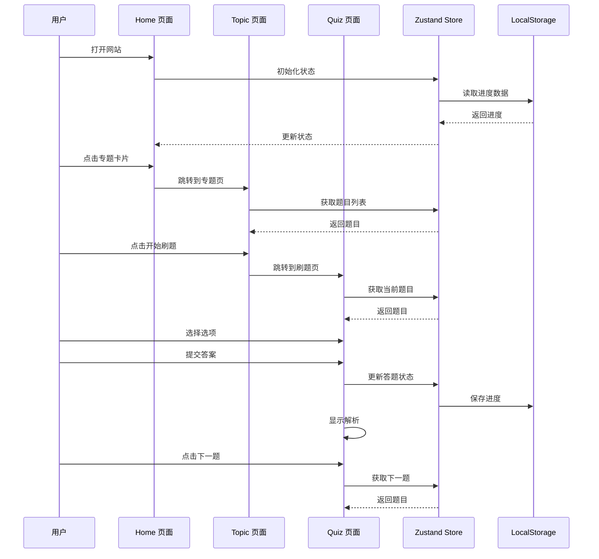

### 状态更新流程

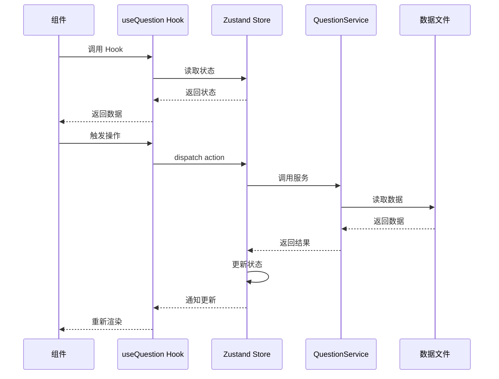

---

## 状态管理图

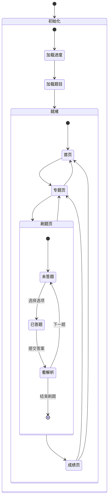

---

## 组件层级图

### App 组件树

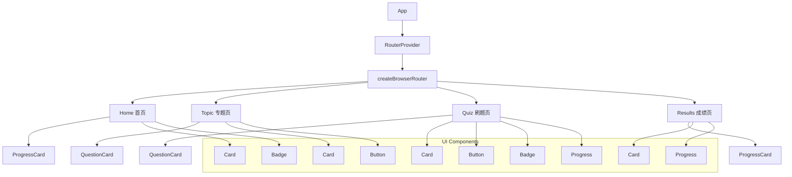

### QuestionCard 组件内部

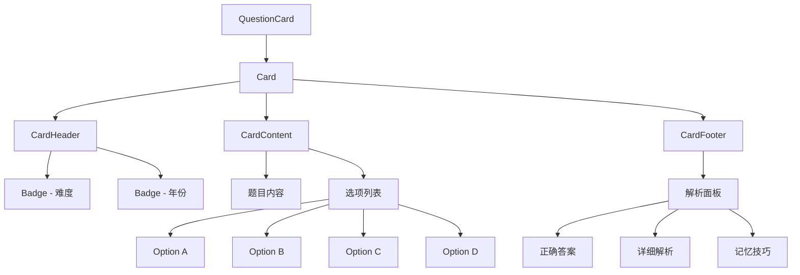

---

## 文件结构树

```
/workspace/
├── src/
│   ├── components/
│   │   ├── ui/                    # UI 基础组件
│   │   │   ├── badge.tsx
│   │   │   ├── button.tsx
│   │   │   ├── card.tsx
│   │   │   ├── progress.tsx
│   │   │   └── tabs.tsx
│   │   ├── Empty.tsx             # 空状态组件
│   │   ├── progress-card.tsx     # 进度卡片
│   │   └── question-card.tsx     # 题目卡片
│   ├── data/
│   │   ├── questions.ts          # 5100+ 题目数据
│   │   └── topics.ts             # 专题数据
│   ├── hooks/
│   │   ├── use-question.ts       # 题目 Hook
│   │   └── useTheme.ts           # 主题 Hook
│   ├── lib/
│   │   ├── utils.test.ts         # 工具函数测试
│   │   └── utils.ts              # 工具函数
│   ├── pages/
│   │   ├── Home.tsx              # 首页
│   │   ├── Quiz.tsx              # 刷题页
│   │   ├── Results.tsx           # 成绩页
│   │   └── Topic.tsx             # 专题页
│   ├── services/
│   │   ├── question-service.test.ts  # 服务测试
│   │   └── question-service.ts       # 题目服务
│   ├── test/
│   │   └── setup.ts              # 测试设置
│   ├── App.tsx                   # 应用入口
│   ├── main.tsx                  # React 入口
│   ├── store.ts                  # Zustand Store
│   ├── types.ts                  # TypeScript 类型
│   ├── index.css                 # 全局样式
│   └── vite-env.d.ts
├── public/
│   └── favicon.svg
├── .trae/
│   └── documents/
│       ├── arch.md
│       └── prd.md
├── .gitignore
├── README.md
├── eslint.config.js
├── index.html
├── package.json
├── playwright.config.ts
├── postcss.config.js
├── tailwind.config.js
├── tsconfig.json
├── vite.config.ts
└── vitest.config.ts
```

---

## 部署架构

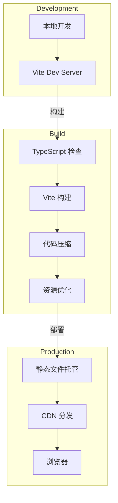

---

## 性能优化策略

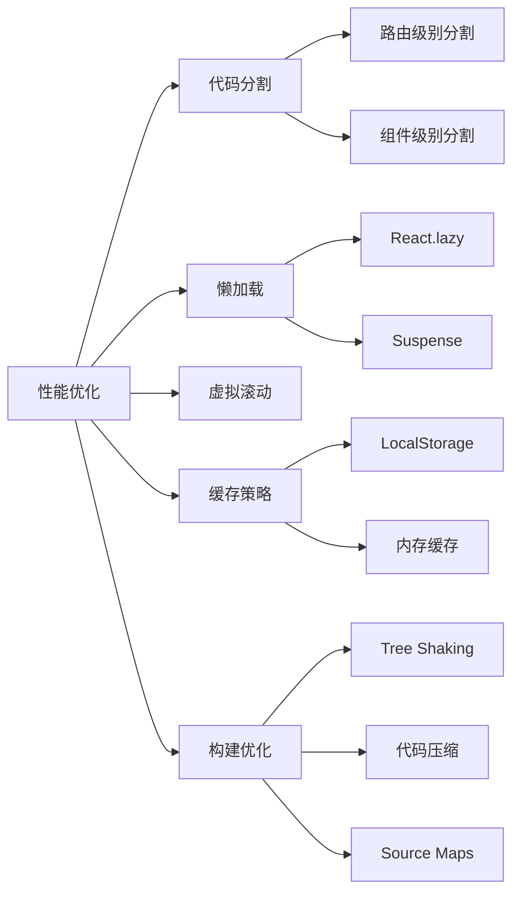

---

## 测试覆盖策略

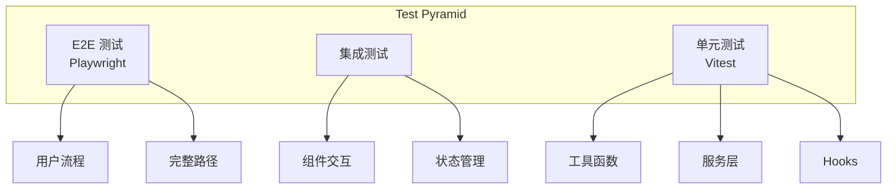
